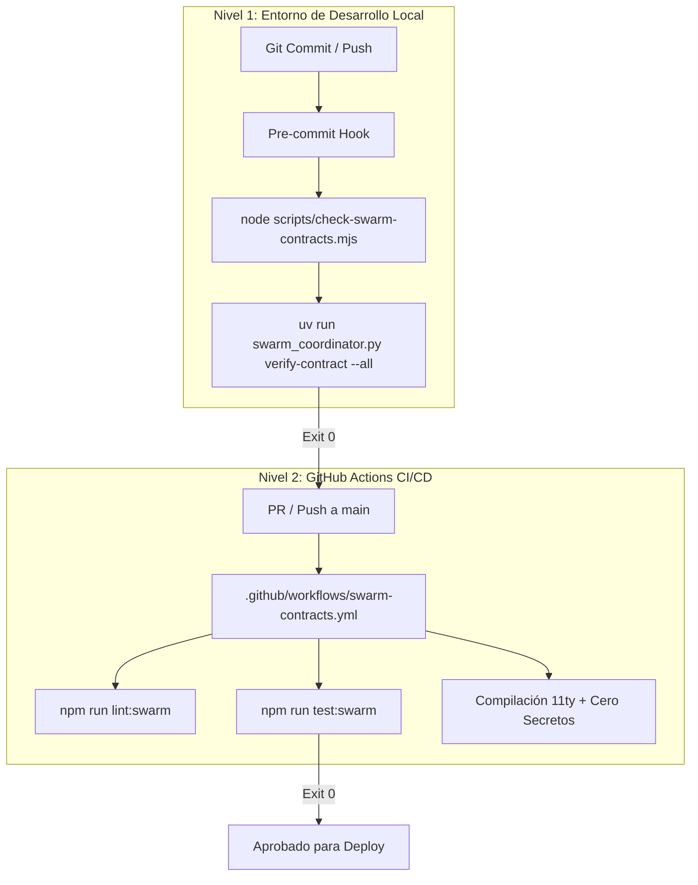

# Integración CI/CD Permanente con KADI Swarm Orchestrator v3.0 Apex

Este documento detalla la arquitectura de integración continua y compuertas de calidad deterministas (*Quality Gates*) para blindar criptográficamente cualquier repositorio del ecosistema KADI mediante **KADI Swarm Orchestrator v3.0**.

---

## 1. Arquitectura de Compuertas en Dos Niveles



---

## 2. Implementación de Referencia en `KadiWebPage`

El repositorio `KadiWebPage` cuenta con la integración completa:

1. **Script de Verificación Rápida y Fallback:**
   [`scripts/check-swarm-contracts.mjs`](KadiWebPage/scripts/check-swarm-contracts.mjs)
   - Valida el manifiesto `.swarm_state/contracts.json`.
   - Si el kernel oficial de Python 3.13 está instalado, delega la verificación en `swarm_coordinator.py verify-contract --all`.
   - Si corre en un entorno Node.js aislado (como un contenedor CI básico), valida los hashes binarios normalizados CRLF→LF de forma autónoma.

2. **Suite de Pruebas Unitarias de Contratos:**
   [`tests/check-swarm-contracts.test.mjs`](KadiWebPage/tests/check-swarm-contracts.test.mjs)
   - Certifica que todos los contratos activos reportan `INTACT`.
   - Simula y detecta adulteraciones de contratos en modo `strict` y `structural`.

3. **Comandos NPM Oficiales (`package.json`):**
   ```bash
   npm run lint:swarm   # Ejecuta la compuerta de contratos
   npm run test:swarm   # Ejecuta las pruebas automatizadas de contratos
   ```

4. **Workflow de GitHub Actions:**
   [`.github/workflows/swarm-contracts.yml`](KadiWebPage/.github/workflows/swarm-contracts.yml)
   - Se dispara en cada `push` a `main`, ramas `audit/**` y en todo `pull_request`.
   - Bloquea cualquier merge si algún contrato SHA-256 (Content o Shape) fue alterado sin pasar por el protocolo DAG de KADI Swarm.

---

## 3. Instalación de Git Hook Local (Pre-commit / Pre-push)

Para habilitar la verificación automática antes de cada commit o push en cualquier máquina de desarrollo:

### En PowerShell (Windows):
```powershell
# En la raíz del repositorio:
$hook = @'
#!/usr/bin/env sh
echo "== KADI Swarm v3.0: Verificando contratos criptograficos..."
node scripts/check-swarm-contracts.mjs || {
  echo "ERROR: Contrato SHA-256 alterado. Ejecuta el protocolo kadi-swarm-orchestrator antes de commitear."
  exit 1
}
'@

[IO.File]::WriteAllText(".git/hooks/pre-commit", $hook.Replace("`r`n", "`n"), (New-Object Text.UTF8Encoding $false))
```

---

## 4. Matriz de Códigos de Salida en CI/CD

| Código | Significado | Acción en el Pipeline |
|---|---|---|
| **Exit 0** | Todos los contratos intactos y congruentes | Pipeline continúa a build y deploy |
| **Exit 1** | Error general o manifiesto corrupto | Pipeline falla; notificar al Orquestador |
| **Exit 3** | Violación de Contrato SHA-256 (Content o Shape) | Pipeline bloquea el PR inmediatamente |
| **Exit 6** | Modelo no autorizado en la telemetría | Pipeline rechaza el despacho |
